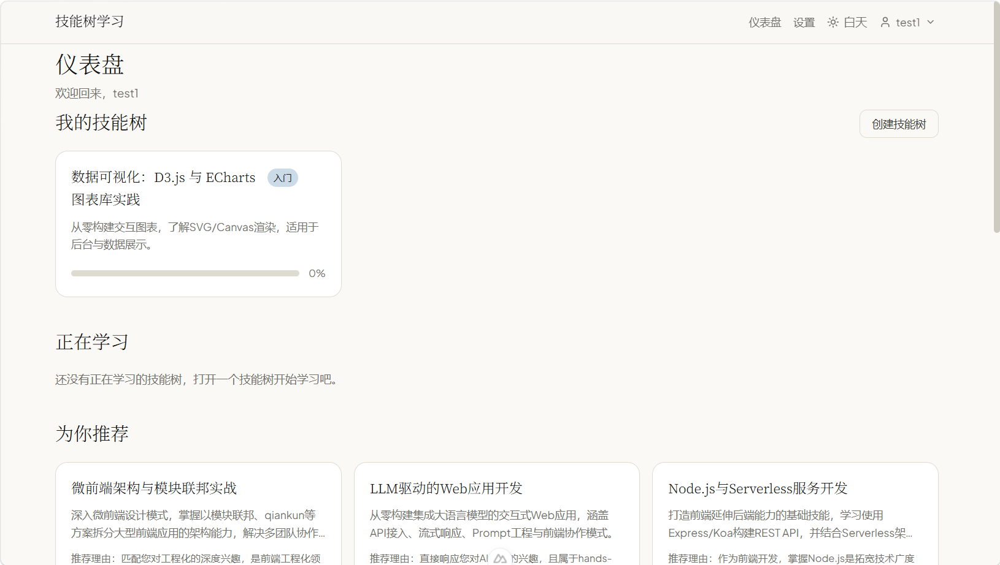
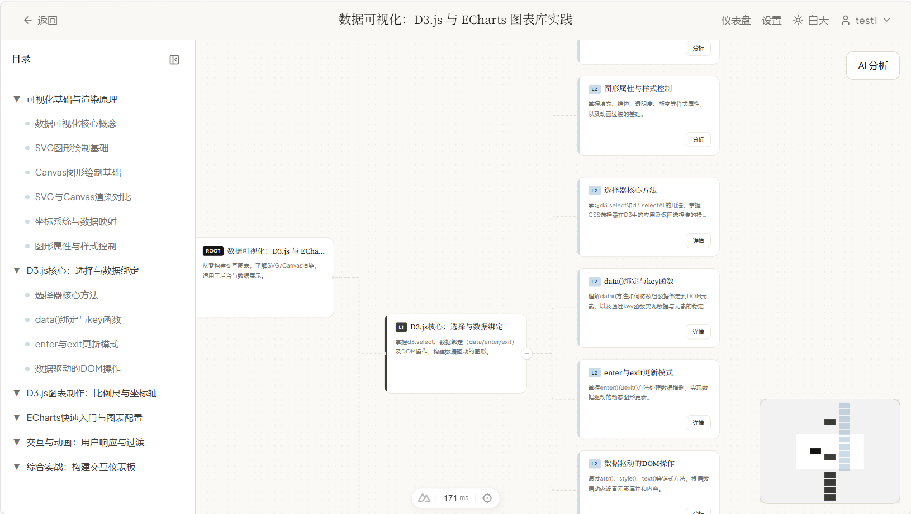

# 技能树学习系统

一个基于 AI 的个性化技能树学习平台。用户通过肖像问卷描述自己的身份、兴趣与目标，系统据此生成学习方向推荐；用户可以创建技能树，AI 会自动梳理 L1/L2 知识点并生成 L3 学习内容（概念、代码演示、练习题），同时支持标记每个节点的学习状态。

<table>
  <tr>
    <td align="center"><b>首页</b></td>
    <td align="center"><b>技能树</b></td>
  </tr>
  <tr>
    <td></td>
    <td></td>
  </tr>
</table>

---

## 功能特性

- **用户与认证**：JWT 注册/登录，Cookie 持久化登录态。
- **肖像问卷**：身份/兴趣/目标/背景四类选择题，AI 生成用户肖像摘要。
- **学习仪表盘**：
  - 我的技能树
  - 正在学习（展示进度与最近学习节点）
  - 为你推荐
- **技能树可视化**：基于 `@vue-flow/core` 的交互式树图，支持：
  - 左侧可折叠目录
  - 节点展开/收起（右侧 +/- 按钮）
  - L2 节点右侧抽屉展示学习内容
  - 节点学习状态标记
- **AI 内容生成**：自动生成 L1 大纲、L2 节点、L3 核心文本/代码示例/练习题。
- **学习状态**：节点可标记为未开始/学习中/已完成/跳过，仪表盘同步展示。
- **面试模式**：面试树专属视图，按 L2 节点分组展示 Q&A；无题节点在打开页面时后台懒生成。
- **AI 分析**：对整棵技能树一键分析，产出「新增节点」与「过期节点」建议，可逐条采纳/忽略。
- **明暗主题**：支持 light / dark / system 三档切换，自动持久化。

---

## 技术栈

- **前端**：Vue 3 + Nuxt 3 + Pinia + Tailwind CSS v4（alpha）+ `@vue-flow/core`
- **后端**：NestJS + TypeORM + PostgreSQL + Passport JWT
- **工作区包**：
  - `@skill/shared`：共享枚举、实体接口、API DTO
  - `@skill/ai-provider`：AI Provider 抽象与实现
  - `@skill/prompt-manager`：Prompt 模板与 JSON 解析
- **包管理器**：pnpm 9.0.0
- **Node.js**：>= 20

---

## 快速开始

### 1. 安装依赖

```bash
pnpm install
```

### 2. 配置环境变量

复制 `.env.example` 为 `.env`，并填写数据库、JWT、AI Provider 等信息：

```bash
cp .env.example .env
```

同时创建前端环境变量文件 `apps/web/.env`：

```bash
# apps/web/.env
NUXT_PUBLIC_API_BASE_URL=http://localhost:3002/api
```

> 注意：Nuxt 不会读取仓库根目录的 `.env`，`NUXT_PUBLIC_API_BASE_URL` 必须放在 `apps/web/.env` 中。

### 3. 启动数据库

确保 PostgreSQL 已运行，并创建对应数据库（默认 `skill_learning`）。

### 4. 启动开发服务器

```bash
pnpm dev
```

该命令会同时启动 API（默认 3002）和 Web（默认 3001）开发服务器，并自动清理占用端口。

也可以单独启动：

```bash
pnpm --filter api start:dev
pnpm --filter web dev
```

### 5. 访问

- Web：http://localhost:3001
- API：http://localhost:3002/api
- Swagger：http://localhost:3002/api/docs

---

## 常用命令

```bash
# 类型检查
pnpm typecheck
pnpm --filter api typecheck
pnpm --filter web typecheck

# 构建
pnpm build

# 运行测试（仅 apps/api 有 Jest 单元测试，见「测试」小节）
pnpm test

# Lint（注意：apps/api 只有 lint 脚本，仓库内没有 eslint 配置与依赖，当前无法执行）
pnpm lint

# 重新构建工作区包（修改 @skill/shared 后必须执行）
pnpm --filter shared build
pnpm --filter ai-provider build
pnpm --filter prompt-manager build
```

沙箱内 pnpm 不可用时，直接用 tsc 重建（PowerShell）：

```powershell
node_modules\.bin\tsc.CMD -p packages/shared/tsconfig.json
node_modules\.bin\tsc.CMD -p packages/shared/tsconfig.cjs.json
node_modules\.bin\tsc.CMD -p packages/prompt-manager/tsconfig.json
node_modules\.bin\tsc.CMD -p packages/ai-provider/tsconfig.json
```

> 在 DSH 沙箱内直接跑 `pnpm <script>` 会因管道 stdio 限制报 `EPERM`，请改用 `node_modules/.bin/*`（`jest` / `ts-node` / `nest` / `typeorm` 在 `apps/api/node_modules/.bin`，`vue-tsc` 在 `apps/web/node_modules/.bin`）。完整替代命令、验证基线与已踩过的坑见 [`AGENTS.md`](./AGENTS.md) 的「本机 / DSH 沙箱下的执行方式」。

---

## 项目结构

```
.
├── apps/
│   ├── api/                 # NestJS 后端
│   └── web/                 # Nuxt 3 前端
├── packages/
│   ├── shared/              # 共享枚举、实体接口、常量
│   ├── ai-provider/         # AI Provider 抽象与实现
│   └── prompt-manager/      # Prompt 模板 + zod 契约层
├── scripts/
│   └── dev.js               # 同时启动 API + Web
├── docs/
│   ├── DESIGN.md            # 视觉/设计系统文档
│   ├── 系统架构设计.md       # 系统架构与数据模型
│   ├── specs/               # 设计文档（AI 契约层与数据流重构等）
│   └── plans/               # 分阶段实施计划 + 验证记录 + 下一阶段交接文档
├── .env.example             # 环境变量示例
├── pnpm-workspace.yaml      # pnpm workspace 配置
└── README.md                # 本文件
```

---

## 环境变量说明

### 根目录 `.env`

| 变量 | 说明 | 示例 |
|------|------|------|
| `DB_HOST` | PostgreSQL 主机 | `localhost` |
| `DB_PORT` | PostgreSQL 端口 | `5432` |
| `DB_USERNAME` | 数据库用户名 | `postgres` |
| `DB_PASSWORD` | 数据库密码 | `` |
| `DB_DATABASE` | 数据库名 | `skill_learning` |
| `JWT_SECRET` | JWT 签名密钥 | `change-me-in-production` |
| `JWT_EXPIRES_IN` | JWT 有效期 | `7d` |
| `AI_PROVIDER` | AI Provider | `deepseek` / `openai` / `mock` |
| `AI_API_KEY` | AI API 密钥 | `` |
| `AI_MODEL` | 模型名称 | `deepseek-chat` |
| `AI_BASE_URL` | API 基础地址 | `https://api.deepseek.com` |
| `AI_L3_MAX_TOKENS` | L3 内容生成 max_tokens | `4096` |
| `API_PORT` | 后端端口 | `3002` |
| `WEB_PORT` | 前端端口（dev.js 使用） | `3001` |

### 前端 `apps/web/.env`

| 变量 | 说明 | 示例 |
|------|------|------|
| `NUXT_PUBLIC_API_BASE_URL` | 后端 API 地址 | `http://localhost:3002/api` |

---

## 开发注意事项

- 修改 `packages/shared` 后，必须重新 build 并清理前端缓存，否则可能拿到旧类型：

  ```bash
  pnpm --filter shared build
  rm -rf node_modules/.vite apps/web/.nuxt
  pnpm dev
  ```

- AI Provider 配置只读取 `.env`，不再从数据库/设置页读取。
- TypeORM `synchronize: false`（**全环境**），schema 变更一律走迁移（`apps/api/src/migrations/`，当前 2 个），命令见 `AGENTS.md` 的「数据库迁移」；生产环境需显式执行 `migration:run`（当前无自动迁移入口）。
- 后端已有 Jest 单元测试（测试文件位于 `apps/api/src` 下、以 `.spec.ts` 结尾），当前 **16 suites / 91 tests** 全绿；命令见 `AGENTS.md` 的「本机 / DSH 沙箱下的执行方式」。前端与 `packages/` 下各包暂无测试。
- 推荐没有定时任务：用户访问推荐接口时按 3 天 TTL 判断，已过期则先返回旧推荐并在后台异步刷新。

---

## 测试

```bash
pnpm test                       # 等价于 turbo run test，当前只有 apps/api 有测试
pnpm --filter api test          # 直接跑 Jest
pnpm --filter api test -- src/modules/interview   # 只跑某个路径下的测试
```

当前覆盖（16 个 suite / 91 个用例）：`extractJson` 解析分支、推荐 TTL、注册/登录、AI 分析建议流、面试题按节点聚合与懒生成、产物状态机与编排（含重新生成）、树归属校验、树/节点服务、内容读写、AI 调用与审计、数据库配置断言、学习记录 DTO 等。

---

## 相关文档

- [DESIGN.md](./docs/DESIGN.md) — 视觉与设计系统
- [系统架构设计.md](./docs/系统架构设计.md) — 系统架构与数据模型
- [docs/plans/](./docs/plans/) — 分阶段实施计划、验证记录与下一阶段交接文档
- [AGENTS.md](./AGENTS.md) — AI 助手项目指南（含本机/沙箱执行命令与验证基线）

---

## License

MIT
