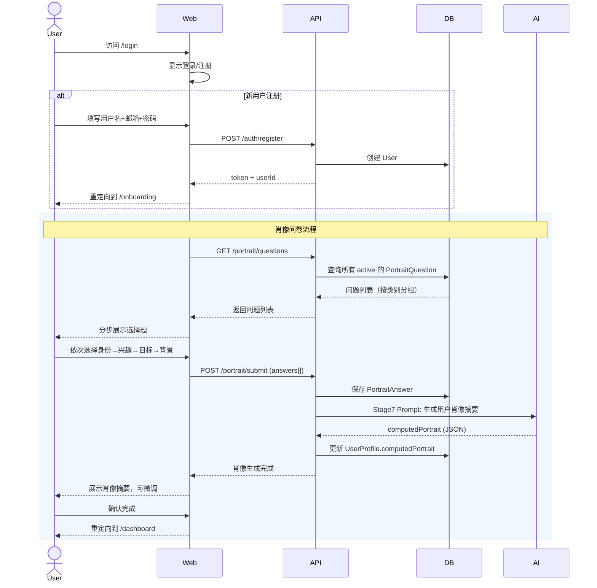
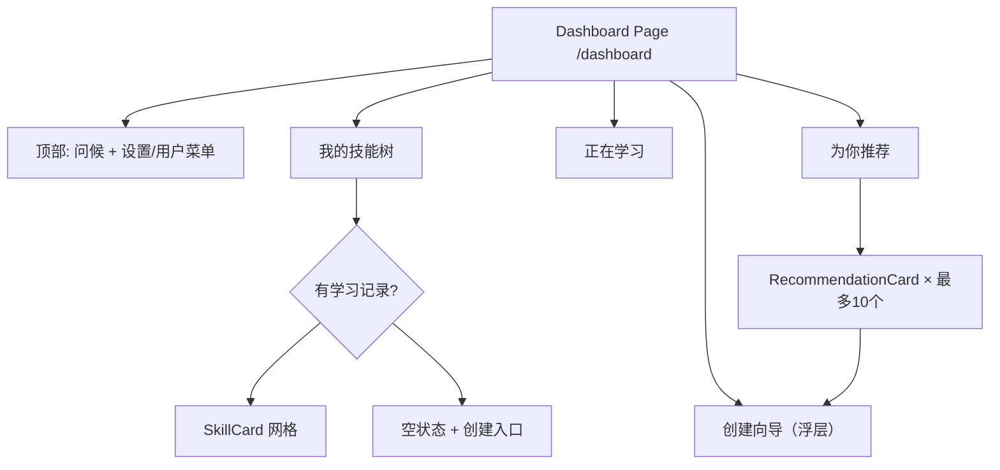
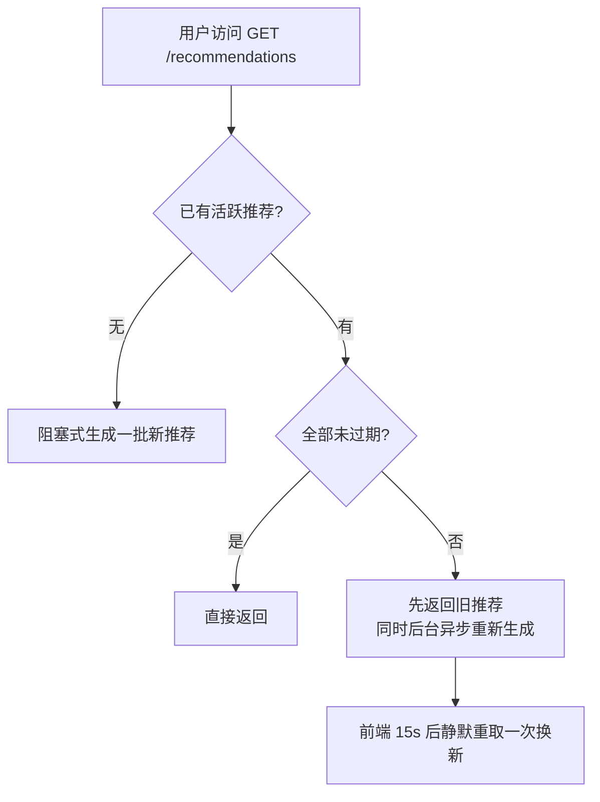
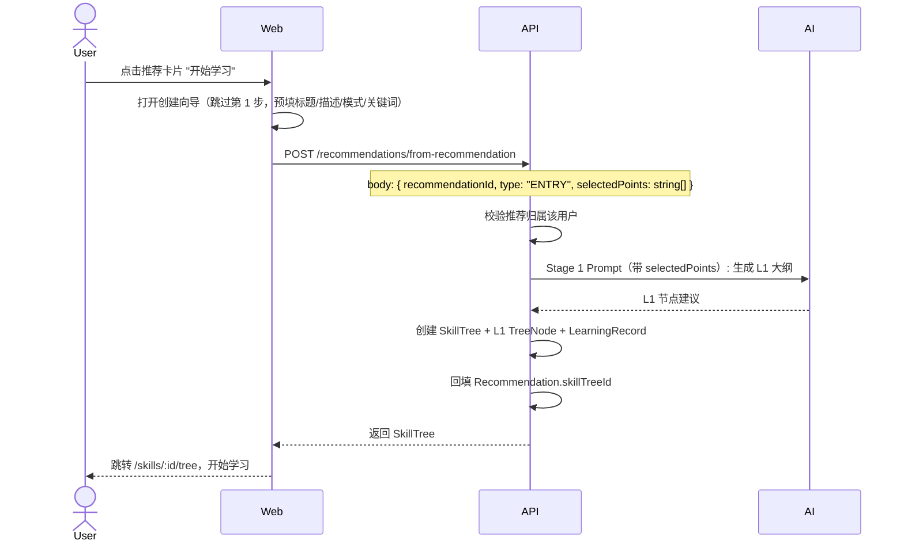
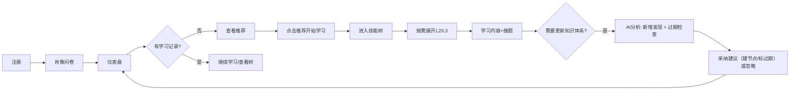
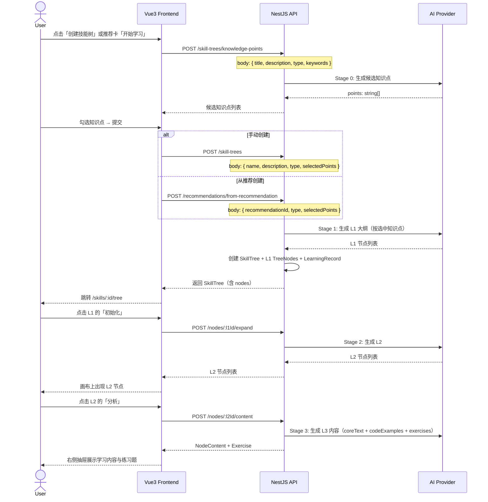

# 技能树学习系统 - 系统架构设计文档

> **文档状态**：已按当前代码（commit `2fe2beb` 之后的工作区状态）校准。文中所有标注「未实现 / 设计稿」的部分均为**尚未落地**的设计意图，不代表代码现状；未标注的即为已实现。接口与字段以 `apps/api/src` 下的控制器与实体为准。

## 一、设计概览

### 1.1 核心概念

| 概念 | 说明 |
|------|------|
| **技能树 (SkillTree)** | 一个完整的学习方向，如"前端工程化""Python 后端开发"，用 `type` 区分模式：`ENTRY`(入门) / `EXPERT`(精进) / `INTERVIEW`(面试)。代码中没有独立的 SkillDirection 实体 |
| **树节点 (TreeNode)** | 两层实体节点：L1(学什么) → L2(具体主题)。L2 是叶节点，其 L3 学习内容存在 `NodeContent`（一对一挂在 L2 上），不是 `TreeNode` 记录 |
| **节点状态** | ACTIVE / OUTDATED_I(不太常用) / OUTDATED_II(建议不用) / OUTDATED_III(建议放弃) |
| **关键点 (KeyPoints)** | **未实现**：设计中的"内容快照"，当前 `TreeNode` 无该字段，分析直接传节点标题/描述清单 |
| **AI Provider** | AI 接入抽象层，配置**只读 `.env`**（`AI_PROVIDER` / `AI_MODEL` / `AI_API_KEY` / `AI_BASE_URL`），无数据库配置 |
| **用户肖像 (UserPortrait)** | 通过身份/兴趣/目标/背景选择题构建的画像，AI 摘要存在 `UserProfile.computedPortrait`，用于个性化推荐 |
| **学习记录 (LearningRecord)** | 用户与技能树的关联：`IN_PROGRESS` / `COMPLETED` / `ABANDONED`；另有节点级的 `NodeLearningRecord` |
| **面试题 (InterviewQuestion)** | L2 节点的派生数据，按节点分组展示、按节点懒生成，随节点删除级联清理 |

### 1.2 Monorepo 结构

```
skill-learning-monorepo/
├── apps/
│   ├── web/                          # Vue3 + Nuxt3 + Pinia + Tailwind
│   │   ├── pages/
│   │   │   ├── index.vue             # 落地页（已登录跳 dashboard）
│   │   │   ├── login.vue             # 登录页
│   │   │   ├── register.vue          # 注册页
│   │   │   ├── onboarding.vue        # 肖像问卷页（注册后引导）
│   │   │   ├── dashboard.vue         # 学习仪表盘（默认首页）
│   │   │   ├── settings.vue          # 全局设置
│   │   │   └── skills/
│   │   │       ├── create.vue        # 创建技能方向
│   │   │       └── [id]/
│   │   │           ├── tree.vue      # 技能树页面
│   │   │           └── interview.vue # 面试模式页面
│   │   ├── components/
│   │   │   ├── portrait/             # 肖像问卷组件
│   │   │   ├── dashboard/            # 仪表盘组件（技能树/正在学习/推荐/创建向导）
│   │   │   ├── tree/                 # 树组件系列（Vue Flow 画布 + 目录 + 抽屉）
│   │   │   ├── interview/            # 面试模式组件
│   │   │   ├── analysis/             # 分析面板组件
│   │   │   └── App*.vue              # 通用组件（按钮/卡片/输入/导航/Toast…）
│   │   ├── composables/              # useApi / useAuthStore / useTreeLayout / …
│   │   ├── stores/                   # 当前为空目录
│   │   └── types/                    # 当前为空目录
│   └── api/                          # NestJS
│       └── src/
│           ├── modules/
│           │   ├── auth/             # 认证模块（JWT）
│           │   ├── user/             # 用户模块
│           │   ├── portrait/         # 肖像问卷模块
│           │   ├── learning-record/  # 学习记录模块（含节点级学习状态）
│           │   ├── recommendation/   # 推荐模块（按需生成 + 3 天 TTL，无定时任务）
│           │   ├── skill-tree/       # 技能树模块
│           │   ├── tree-node/        # 节点模块
│           │   ├── content/          # 内容模块（NodeContent + Exercise 同模块）
│           │   ├── dashboard/        # 仪表盘聚合模块
│           │   ├── interview/        # 面试模式模块（题目挂在 L2 节点）
│           │   ├── analysis/         # AI 分析模块（按整棵树）
│           │   └── ai-integration/   # AI 接入层模块
│           ├── config/               # 数据库配置（database.config.ts）
│           ├── seeds/                # 肖像问卷种子数据
│           ├── health/               # 健康检查
│           └── common/
├── packages/
│   ├── shared/                       # @skill/shared：共享类型、常量、枚举
│   ├── ai-provider/                  # @skill/ai-provider：AI Provider 抽象层
│   └── prompt-manager/               # @skill/prompt-manager：Prompt 模板管理
├── scripts/dev.js                    # 同时启动 API + Web（先清理 3001/3002 端口）
└── pnpm-workspace.yaml
```

---

## 二、数据模型设计

### 2.1 核心实体关系

```mermaid
erDiagram
    User ||--o| UserProfile : has
    User ||--o{ LearningRecord : has
    User ||--o{ Recommendation : receives
    UserProfile ||--o{ PortraitAnswer : contains
    PortraitQuestion ||--o{ PortraitAnswer : answered_by
    LearningRecord ||--o| SkillTree : tracks
    Recommendation ||--o| SkillTree : "nullable, may refer to"
    SkillTree ||--o{ TreeNode : contains
    TreeNode ||--o{ TreeNode : "parent-child"
    TreeNode ||--o| NodeContent : "L2 节点持有 L3 内容"
    NodeContent ||--o{ Exercise : contains
    SkillTree ||--o{ AnalysisJob : "整棵树分析"
    AnalysisJob ||--o{ SuggestedChange : produces
    TreeNode ||--o{ InterviewQuestion : "L2 节点出题，级联删除"

    User {
        string id PK
        string username
        string email
        string passwordHash
        string avatar
        enum role "USER | ADMIN"
        datetime createdAt
        datetime updatedAt
    }

    UserProfile {
        string id PK
        string userId FK "unique"
        json computedPortrait "AI生成的肖像摘要，用于推荐"
        datetime portraitUpdatedAt
        datetime createdAt
        datetime updatedAt
    }

    PortraitQuestion {
        string id PK
        string category "IDENTITY | INTEREST | GOAL | BACKGROUND"
        string question
        json options "string[]"
        bool allowMultiple "true=多选 | false=单选"
        int sortOrder
        bool active
        datetime createdAt
    }

    PortraitAnswer {
        string id PK
        string profileId FK
        string questionId FK
        json selectedOptions "string[]"
        datetime createdAt
    }

    LearningRecord {
        string id PK
        string userId FK
        string skillTreeId FK
        enum status "IN_PROGRESS | COMPLETED | ABANDONED"
        datetime startedAt
        datetime completedAt
    }

    Recommendation {
        string id PK
        string userId FK
        string skillTreeId FK "nullable, 如果是已有技能方向则关联"
        string title
        text description
        text reason "AI生成的推荐理由（基于用户肖像的什么方面）"
        json matchTags "匹配维度标签，前端展示用"
        string suggestedMode "建议从哪个模式开始"
        json keywords "创建技能树时用于生成知识点"
        string source "AI_GENERATED | MANUAL"
        bool isActive "true=当前活跃推荐 | false=已被替换"
        int sortOrder
        datetime createdAt
        datetime expireAt "该推荐失效时间（生成时 +3 天）"
    }

    %% 设计稿中的 RecommendationJob（singleton 定时任务记录）未实现，代码中无该实体

    SkillTree {
        string id PK
        string name "技能方向名称"
        string description
        enum type "ENTRY | EXPERT | INTERVIEW"
        enum status "ACTIVE | ARCHIVED"
        datetime createdAt
        datetime updatedAt
    }

    TreeNode {
        string id PK
        string treeId FK
        string parentId FK "nullable for L1"
        int level "1 | 2（代码用 NodeLevel 枚举，实际只生成 L1/L2）"
        string title
        text description
        enum status "ACTIVE | OUTDATED_I | OUTDATED_II | OUTDATED_III"
        int sortOrder
        datetime createdAt
        datetime updatedAt
    }

    %% TreeNode.keyPoints：二期设计字段，当前代码中不存在（见 2.2 节）

    NodeContent {
        string id PK
        string nodeId FK "unique, 挂在 L2 节点上"
        text coreText "精简核心文本"
        int version
        datetime createdAt
        datetime updatedAt
    }

    Exercise {
        string id PK
        string nodeContentId FK
        string question
        json options "string[]"
        int correctIndex
        text explanation
        int sortOrder
    }

    AnalysisJob {
        string id PK
        string treeId FK "整棵树（不是单个节点）"
        enum analysisType "DISCOVER_NEW | CHECK_EXPIRE"
        text promptSnapshot "生成的prompt原文"
        json rawResponse "AI原始返回"
        enum status "PENDING | COMPLETED | FAILED"
        datetime createdAt
    }

    SuggestedChange {
        string id PK
        string analysisJobId FK
        enum action "ADD | EXPIRE"
        string title
        text description
        text reason
        string parentNodeId "action=ADD 时建议挂载的 L1；为空=建议新增 L1"
        string targetNodeId "action=EXPIRE 时的目标节点"
        enum expireLevel "I | II | III" "action=EXPIRE时填写"
        enum status "PENDING | APPLIED | IGNORED"
        datetime createdAt
    }

    InterviewQuestion {
        string id PK
        string treeId FK
        string l2NodeId FK "题目所属 L2 节点，级联删除"
        text question
        text answer
        enum difficulty "EASY | MEDIUM | HARD"
        int sortOrder
        datetime createdAt
    }
```

### 2.2 关键字段详解

#### TreeNode.keyPoints

> 注：该字段**当前代码中不存在**（`tree-node.entity.ts` 无该列）。实际实现的分析功能（stage 4/5）不使用 keyPoints，而是把整棵树的 L1/L2 标题与描述清单直接传给 AI。

节点的"内容指纹"，用于 AI 分析时快速理解节点含义，不必遍历子节点全部内容。

```
示例（L2 节点 "Docker 容器化"）：
keyPoints: "Dockerfile 编写|docker-compose 编排|镜像优化|容器网络|与 CI/CD 集成"
```

设计中的作用场景（未实现）：
- L1 分析新增/过期 → 读取所有 L2 的 keyPoints 传给 AI，AI 基于此判断
- L2 分析新增/过期 → 读取所有 L3 的 keyPoints 传给 AI
- 不需要遍历完整内容树，效率高

#### TreeNode.status 与过期等级

| 状态 | 标识 | 含义 | 对用户的影响 |
|------|------|------|-------------|
| ACTIVE | - | 活跃内容 | 正常显示 |
| OUTDATED_I | ⚠️ I | 不太常用 | 显示灰色标记，内容仍可查看 |
| OUTDATED_II | ⚠️ II | 建议不用 | 显示标记，内容仍可查看 |
| OUTDATED_III | ❌ III | 建议放弃 | 显示标记；「彻底清理」仅在设计稿中，当前无清理端点 |

> 实际实现：状态由分析建议（`action=EXPIRE`）采纳后写入，或通过 `PATCH /nodes/:id` 直接修改；前端按状态降透明度并打「已过时」标记。

#### UserProfile.computedPortrait

用户完成问卷后，AI 基于其答案生成的肖像摘要，用于推荐系统。

```
示例：
{
  "summary": "3年前端开发经验，正在向全栈方向转型，
             对云原生和AI应用开发感兴趣，偏好实战型学习路径",
  "identityTags": ["前端工程师", "3-5年经验", "互联网行业"],
  "interestTags": ["云原生", "AI应用", "全栈"],
  "goalTags": ["职业转型", "技术广度提升"],
  "learningStyle": "hands-on"
}
```

---

## 三、用户肖像系统

### 3.1 注册与肖像设置流程



### 3.2 肖像问卷题目设计

题目分为 4 个类别，**当前种子数据共 8 题（每类 2 题）**，其中兴趣领域与学习目标为多选。题目与实际选项以下表为准（`apps/api/src/seeds/portrait-questions.seed.ts`）。

| 类别 | 题目 | 选项 | 多选 |
|------|------|------|------|
| **身份 IDENTITY** | 你当前的职业身份是什么？ | 学生/前端开发/后端开发/全栈开发/产品经理/设计师/其他 | 否 |
| **身份 IDENTITY** | 你的工作年限？ | <1年/1-3年/3-5年/5-10年/10年+ | 否 |
| **兴趣 INTEREST** | 你对哪些技术领域感兴趣？ | 云原生/AI与机器学习/微服务/DevOps/前端工程化/数据工程/安全 | **是** |
| **兴趣 INTEREST** | 你偏好的学习方式？ | 视频教程/文档阅读/实战项目/交互式练习 | 否 |
| **目标 GOAL** | 你当前的主要学习目标？ | 求职面试/技术转型/晋升加薪/兴趣拓展/解决当前工作问题 | **是** |
| **目标 GOAL** | 你希望学习的深度？ | 够用就行/系统掌握/深入原理/成为专家 | 否 |
| **背景 BACKGROUND** | 你当前的编程基础？ | 零基础/有基础/熟练/精通 | 否 |
| **背景 BACKGROUND** | 你每天能投入的学习时间？ | <30分钟/30-60分钟/1-2小时/2小时+ | 否 |

每题支持「其他」自定义文本，提交时以 `其他：<用户输入>` 的形式落库。

设计原则：
- 题目本身由系统预置（种子数据），不是 AI 生成
- 答案按类别格式化后拼入 prompt，由 AI 生成肖像摘要
- 设计中的「后端接口管理题目」未实现（只有 `GET /portrait/questions` 与 `POST /portrait/submit`）

### 3.3 肖像摘要生成 Prompt（Stage 7）

```
角色: 你是一个用户画像分析师
任务: 基于用户的问卷调查答案，生成用户肖像摘要

输入:
- 身份信息: {{identityAnswers}}
- 兴趣偏好: {{interestAnswers}}
- 学习目标: {{goalAnswers}}
- 背景信息: {{backgroundAnswers}}

输出要求:
1. summary: 一段自然语言描述（50字以内），概括用户当前状态
2. identityTags: 3-5个身份标签
3. interestTags: 3-5个兴趣标签
4. goalTags: 2-4个目标标签
5. learningStyle: 学习偏好标签

输出格式 (JSON):
{
  "summary": "...",
  "identityTags": ["...", "..."],
  "interestTags": ["...", "..."],
  "goalTags": ["...", "..."],
  "learningStyle": "..."
}
```

---

## 四、仪表盘页面设计

### 4.1 页面布局



> 实际实现没有 List/Grid 视图切换：三个区块都是 `sm:grid-cols-2 lg:grid-cols-3` 响应式网格，`loading` 态统一用骨架屏。

### 4.2 路由更新

```
/                                → 落地页（已登录跳 /dashboard）
/login                           → 登录页
/register                        → 注册页
/onboarding                      → 肖像问卷引导页（首次登录后）
/dashboard                       → 学习仪表盘（登录后默认首页）
/skills/create                   → 创建新技能（输入名称+选择模式）
/skills/:id/tree                 → 技能树主页
/skills/:id/interview            → 面试模式视图（仅 INTERVIEW 树有入口按钮）
/settings                        → 全局设置
```

### 4.3 仪表盘组件树（实际）

```
pages/dashboard.vue
├── DashboardHeader.vue                 # 用户欢迎语 + 用户菜单
├── DashboardLearningSection.vue        # "我的技能树" 区块（网格 + 创建/删除）
│   └── DashboardSkillCard.vue          # 技能卡：名称 + 模式 + 进度条 + 操作
├── DashboardCurrentLearningSection.vue # "正在学习" 区块（进度 + 最近学习节点）
├── DashboardRecommendationSection.vue  # "为你推荐" 区块
│   └── DashboardRecommendationCard.vue # 方向名称 + 匹配标签 + 推荐理由 + "开始学习"
├── DashboardSkillTreeWizard.vue        # 三步创建向导（填写信息 → 梳理知识点 → 选择知识点）
└── AppSkeleton.vue                     # 三个区块统一用它做 loading 骨架
    └── DashboardSkeletonCard.vue       # 卡片骨架（AppSkeleton 的 dashboard-card 变体）
```

> 组件按目录前缀自动注册（`components/dashboard/` → `Dashboard*`），因此文件名不带 `Dashboard` 前缀而模板里带。
> `EmptyState.vue` 只用于面试页 / L3 内容 / 分析面板，不在仪表盘使用。

### 4.4 SkillCard 与 RecommendationCard 视觉示意

```
┌─────────────────────────┐        ┌─────────────────────────┐
│  前端工程化              │        │  AI应用开发              │
│  🏷️ 入门 · 精进 · 面试  │        │  🏷️ 推荐理由: 你正在向   │
│  ████████░░ 68%         │        │     全栈转型...         │
│  [继续学习]              │        │  🔗 匹配: 兴趣 + 目标   │
└─────────────────────────┘        │  [开始学习]              │
    SkillCard (我的学习)            └─────────────────────────┘
                                         RecommendationCard
```

---

## 五、推荐系统

### 5.1 触发时机（实际实现：按需 + TTL）

> 设计稿原本是「服务启动 + 每天 Cron 检查，>7 天则全量刷新」。**该定时任务未实现**：仓库没有 `@nestjs/schedule` 依赖，代码中也没有 `@Cron`，`RecommendationJob` 实体不存在。

实际逻辑（`recommendation.service.ts`，`RECOMMENDATION_TTL_DAYS = 3`）：



- 生成入口：`GET /recommendations`（无活跃推荐时阻塞生成）、`POST /recommendations/refresh`（手动刷新）。
- 并发去重：同一 userId 同时只跑一次生成（`Map<userId, Promise>`）。
- 新旧交替：新推荐落库前把该用户所有活跃推荐置 `isActive = false`；新推荐的 `expireAt = now + 3 天`。
- 生成失败只记日志，不影响旧推荐返回。

### 5.2 推荐生成 Prompt（Stage 8）

> 下方为当前模板（`stage-8-recommendations.ts`）的实际输入输出结构，推荐数量上限由 `MAX_RECOMMENDATIONS = 10` 约束。

```
角色: 你是一个个性化学习路径规划师
任务: 基于用户的肖像和当前学习情况，推荐最适合的 10 个学习方向

输入:
- 用户肖像: portrait.summary / identityTags / interestTags / goalTags / learningStyle
- 正在学习的技能: learningSkills[{ name, type, description }]
- 上次推荐: oldRecommendations[{ title, reason }]

输出格式 (JSON):
{
  "recommendations": [
    {
      "title": "...",              // 学习方向名称，如"云原生架构"
      "description": "...",        // 一句话描述
      "reason": "...",             // 推荐理由，如"你对云原生感兴趣且有后端基础"
      "matchTags": ["兴趣", "目标"],// 匹配维度标签，前端展示用
      "suggestedMode": "ENTRY",    // 建议从哪个模式开始
      "keywords": ["...", "..."]   // 创建技能树时用于生成知识点
    }
  ]
}
```

### 5.3 推荐生成逻辑（实际实现）

```typescript
// apps/api/src/modules/recommendation/recommendation.service.ts

/** 读取：无推荐则阻塞生成；已过期则先返回旧的 + 后台刷新 */
async findForUser(userId: string): Promise<Recommendation[]> {
  const active = await this.findActiveByUser(userId);
  if (active.length === 0) return this.refreshForUser(userId);

  const allValid = active.every((r) => r.expireAt && r.expireAt > new Date());
  if (allValid) return active;

  this.refreshInBackground(userId); // void + catch，仅记日志
  return active;
}

/** 同一用户并发生成去重 */
async refreshForUser(userId: string): Promise<Recommendation[]> {
  const existing = this.generating.get(userId);
  if (existing) return existing;
  const promise = this.generateForUser(userId).finally(() => this.generating.delete(userId));
  this.generating.set(userId, promise);
  return promise;
}

async generateForUser(userId: string): Promise<Recommendation[]> {
  const profile = await this.userService.getProfile(userId);
  const portrait = (profile?.computedPortrait as Record<string, unknown>) || {};

  // 学习记录 → 技能树摘要（过滤 ABANDONED；树查不到时跳过）
  const records = await this.learningRecordService.findByUser(userId);
  const learningSkills = await Promise.all(
    records
      .filter((r) => r.status !== LearningStatus.ABANDONED)
      .map(async (r) => {
        const tree = await this.skillTreeService.findById(r.skillTreeId).catch(() => null);
        return { name: tree?.name || '', type: tree?.type || '', description: tree?.description };
      }),
  );

  const oldRecs = await this.recommendationRepo.find({
    where: { userId, isActive: true },
    order: { sortOrder: 'ASC' },
  });

  const result = await this.aiService.generateRecommendations({
    portrait,
    learningSkills: learningSkills.filter((s) => s.name),
    oldRecommendations: oldRecs.map((r) => ({ title: r.title, reason: r.reason })),
  });

  const expireAt = new Date();
  expireAt.setDate(new Date().getDate() + RECOMMENDATION_TTL_DAYS);

  // 旧推荐先整体失活，再写入新一批
  await this.recommendationRepo.update({ userId, isActive: true }, { isActive: false });

  const recommendations = (result.recommendations || [])
    .slice(0, MAX_RECOMMENDATIONS)
    .map((item, index) => this.recommendationRepo.create({
      userId, title: item.title, description: item.description, reason: item.reason,
      matchTags: item.matchTags ?? [], suggestedMode: item.suggestedMode,
      keywords: item.keywords ?? [], source: RecommendationSource.AI_GENERATED,
      isActive: true, sortOrder: index, createdAt: new Date(), expireAt,
    }));

  return this.recommendationRepo.save(recommendations);
}
```

### 5.4 从推荐创建学习方向



> 说明：推荐每次都会**新建**一棵技能树（该接口不做「复用已有树」判断）；`selectedPoints` 来自向导第 2/3 步（先 `POST /skill-trees/knowledge-points` 拿候选知识点，用户勾选后再提交）。

---

## 六、核心业务流程

### 6.1 完整用户旅程



### 6.2 创建技能方向（接推荐）



> 实际没有 `PATCH /skill-trees/:id/confirm`（L1 无需确认）；L1 由创建时一次性生成，L2/L3 按需展开。

---

## 七、前端路由与组件设计

### 7.1 完整路由表

```
/                                → 落地页（已登录跳转 /dashboard）
/login                           → 登录页
/register                        → 注册页
/onboarding                      → 肖像问卷引导（首次登录）
/dashboard                       → 学习仪表盘（默认首页）
/skills/create                   → 手动创建技能方向（复用创建向导）
/skills/:id/tree                 → 技能树主页
/skills/:id/interview            → 面试模式视图
/settings                        → 全局设置（仅「重新设置肖像」入口）
```

> 没有 `/settings/portrait` 路由：重新设置肖像直接跳 `/onboarding`。

### 7.2 完整组件树

```
// 认证相关
pages/login.vue
pages/register.vue

// 肖像问卷
pages/onboarding.vue
├── PortraitProgressBar.vue       # 分步进度条（4步: 身份→兴趣→目标→背景）
├── PortraitQuestionStep.vue      # 单步问题卡片（含多选/单选 + 自定义文本）
└── PortraitSummary.vue           # 确认页（展示AI生成的肖像摘要）

// 仪表盘
pages/dashboard.vue
├── DashboardHeader.vue            # 用户欢迎语 + 用户菜单
├── DashboardLearningSection.vue   # "我的技能树" 区块
│   └── DashboardSkillCard.vue     # 技能卡：名称 + 模式 + 进度条 + 继续学习/删除
├── DashboardCurrentLearningSection.vue # "正在学习"：进度 + 最近学习节点
├── DashboardRecommendationSection.vue  # "为你推荐"
│   └── DashboardRecommendationCard.vue # 匹配标签 + 理由 + "开始学习"
├── DashboardSkillTreeWizard.vue   # 三步创建向导（信息 → 梳理知识点 → 勾选知识点）
└── AppSkeleton / DashboardSkeletonCard # 三个区块的 loading 骨架

// 技能树（当前实现：Vue Flow 画布 + 左侧目录 + 右侧抽屉）
pages/skills/[id]/tree.vue        # fullscreen 布局，组合以下三部分
├── TreeDirectoryPanel.vue        # 左侧目录：L1→L2 列表、点击定位/折叠、状态圆点
│   └── TreeLearningStatusDot.vue # 学习状态圆点（学习中/已完成/跳过）
├── TreeVueFlowGraph.vue          # @vue-flow/core 画布：平移/缩放、连线、fitView
│   └── TreeFlowNode.vue          # 自定义节点：标题/描述、时效徽标、学习状态、L1 展开按钮
├── TreeL2ContentPanel.vue        # 右侧抽屉（选中 L2 时打开）
│   ├── 学习状态切换按钮组         # 未开始/学习中/已完成/跳过
│   └── TreeL3Content.vue         # L3 内容：Markdown 渲染、代码高亮/复制
│       └── TreeExerciseCard.vue  # 练习题卡片（选项选择/判分/解析）
└── AnalysisPanel.vue             # 右侧「AI 分析」抽屉（与内容抽屉互斥，z-40）
    └── 展示 PENDING 建议，逐条采纳 / 忽略

状态与布局：
├── composables/useSkillTreePage.ts # 页面状态：选中/折叠、内容加载、学习状态更新
├── composables/useTreeLayout.ts    # 树数据 → Vue Flow nodes/edges（根→L1→L2 横向布局）
└── utils/learning-status.ts        # 学习状态元信息（label/徽标/圆点类名）

// 面试模式
pages/skills/[id]/interview.vue   # 按 L2 节点分组；空题组显示"生成中"，15s 静默重取（最多 2 次）
├── InterviewDifficultyFilter.vue # ALL/EASY/MEDIUM/HARD 过滤 + 计数
└── InterviewQuestionCard.vue     # 单题卡片（题干/答案/难度）

// 设置
pages/settings.vue                # 仅一张卡片：「重新设置肖像」→ /onboarding
```

---

## 八、API 端点设计

### 8.1 认证

| 方法 | 路径 | 说明 |
|------|------|------|
| POST | /api/auth/register | 注册 |
| POST | /api/auth/login | 登录（返回 JWT） |

### 8.2 用户肖像

| 方法 | 路径 | 说明 |
|------|------|------|
| GET | /api/portrait/questions | 获取所有活跃的肖像问卷题目（按类别分组） |
| POST | /api/portrait/submit | 提交问卷答案 + AI生成肖像摘要（原始答案落库 PortraitAnswer） |

> 设计稿中的 `PUT /api/portrait/questions`（管理端增删改题目）未实现。题目来自种子数据 `apps/api/src/seeds/portrait-questions.seed.ts`。

### 8.3 仪表盘

| 方法 | 路径 | 说明 |
|------|------|------|
| GET | /api/dashboard | 返回 `{ portrait, learningRecords, currentLearning }`；推荐走单独的 `/api/recommendations` |

### 8.4 推荐

| 方法 | 路径 | 说明 |
|------|------|------|
| GET | /api/recommendations | 获取当前活跃推荐列表（无推荐则阻塞生成；已过期先返回旧的 + 后台刷新） |
| POST | /api/recommendations/refresh | 手动触发推荐刷新 |
| POST | /api/recommendations/from-recommendation | 从推荐创建技能树（含自动生成 L1） |

> 设计稿中的 `GET /api/recommendations/job-status` 未实现（没有定时任务，也就没有任务状态）。

### 8.5 学习记录

| 方法 | 路径 | 说明 |
|------|------|------|
| GET | /api/learning-records | 获取用户的所有学习记录 |
| POST | /api/learning-records | 创建学习记录（关联技能树） |
| PATCH | /api/learning-records/:id | 更新学习状态 |
| DELETE | /api/learning-records/:id | 删除学习记录（放弃学习） |
| GET | /api/skill-trees/:treeId/progress | 某棵树的节点级学习状态映射 `{ statusByNodeId }` |
| POST | /api/skill-trees/:treeId/nodes/:nodeId/learning-status | 更新单个节点的学习状态 |

### 8.6 用户

| 方法 | 路径 | 说明 |
|------|------|------|
| GET | /api/users/me | 当前用户信息（含肖像摘要） |
| PATCH | /api/users/me | 更新用户信息 |

### 8.7 技能树

| 方法 | 路径 | 说明 |
|------|------|------|
| POST | /api/skill-trees/knowledge-points | Stage 0：生成候选知识点（向导第 2 步） |
| POST | /api/skill-trees | 手动创建技能方向（可按 selectedPoints 生成 L1） |
| GET | /api/skill-trees/:id | 技能树详情（含 nodes） |
| PATCH | /api/skill-trees/:id | 更新技能树 |
| DELETE | /api/skill-trees/:id | 删除技能树（解绑推荐 → 删内容/节点/学习记录 → 删树） |

> 设计稿中的 `GET /api/skill-trees`（列表）未实现：仪表盘通过 `GET /api/dashboard` 拿学习记录来展示技能树。

### 8.8 节点操作

| 方法 | 路径 | 说明 |
|------|------|------|
| GET | /api/nodes/:id/children | 获取子节点 |
| POST | /api/nodes/:id/expand | 按需展开（AI 生成 L2） |
| GET | /api/nodes/:id | 节点详情 |
| PATCH | /api/nodes/:id | 编辑节点（标题/描述/状态） |
| DELETE | /api/nodes/:id | 删除节点 |

> 设计稿中的 `PATCH /api/nodes/batch-confirm`、`DELETE /api/nodes/:id/cleanup` 未实现。

### 8.9 内容与练习

| 方法 | 路径 | 说明 |
|------|------|------|
| POST | /api/nodes/:id/content | 生成 L3 内容（已存在则直接返回） |
| GET | /api/nodes/:id/content | 获取 L3 内容（不存在返回 null） |
| PATCH | /api/nodes/:id/content | 编辑内容 |

### 8.10 分析（按整棵树）

| 方法 | 路径 | 说明 |
|------|------|------|
| POST | /api/skill-trees/:id/analysis | 触发「新增发现 + 过期检查」，返回本次产生的建议 |
| GET | /api/skill-trees/:id/analysis/suggestions | 该树所有 PENDING 建议 |
| POST | /api/analysis/suggestions/:sid/apply | 采纳建议（ADD 建节点 / EXPIRE 标过期） |
| POST | /api/analysis/suggestions/:sid/ignore | 忽略建议 |

> 设计稿是**按节点**分析（`POST /api/nodes/:id/analyze`、`GET /api/analysis/:jobId/results`），实际实现为**按树**一键分析；`AnalysisJob` 仍会落库（含 promptSnapshot / rawResponse），但没有单独的 job 查询端点。

### 8.11 面试模式

| 方法 | 路径 | 说明 |
|------|------|------|
| GET | /api/skill-trees/:id/interview | 按 L2 节点分组返回 Q&A；无题节点触发后台懒生成（响应不阻塞） |

### 8.12 配置

> 设计稿中的 `GET/PUT /api/config/ai` 未实现。AI Provider 配置**只读 `.env`**，数据库全局配置（`GlobalConfig`）已移除。

### 8.13 健康检查

| 方法 | 路径 | 说明 |
|------|------|------|
| GET | /api/health | 健康检查（唯一不需要 JWT 的业务端点） |

---

## 九、Prompt 阶段汇总

| Stage | 模板名 | 名称 | 触发时机 | 输出 |
|-------|--------|------|----------|------|
| 0 | `knowledge-points` | 生成候选知识点 | 创建向导第 2 步 | `points: string[]` |
| 1 | `l1-outline` | 生成 L1 大纲 | 创建技能方向 | L1 节点列表 |
| 2 | `l2-nodes` | 展开 L2 | 展开 L1（`POST /nodes/:id/expand`） | L2 节点列表 |
| 3 | `l3-content` | 生成 L3 内容 | 展开 L2（`POST /nodes/:id/content`） | 核心文本 + 代码示例 + 练习题 |
| 4 | `discover-new` | 分析新增节点 | 整棵树分析 | 建议新增的节点 |
| 5 | `check-expire` | 分析过期节点 | 整棵树分析 | 建议标记过期的节点 |
| 6 | `interview-qa` | 面试题 | 打开面试页、对无题 L2 节点懒生成 | 单个 L2 主题的 3-5 道 Q&A |
| 7 | `portrait` | 生成肖像摘要 | 用户提交问卷 | 用户肖像 JSON |
| 8 | `recommendations` | 生成推荐 | 用户访问推荐接口（按需 + 3 天 TTL） | 推荐列表 × 最多 10 |

> 全部 9 个 stage 均已注册（`packages/prompt-manager/src/prompt-manager.ts`）。stage 4/5/6 的输入都带 `existingSuggestions` 用于去重（stage 6 为单主题输入，不带）。

---

## 十、NestJS 模块清单（实际）

### 10.1 api/src/modules/

```
modules/
├── auth/                          # 认证（JWT）
│   ├── auth.module.ts / controller / service
│   ├── dto/ (login, register)
│   ├── guards/jwt-auth.guard.ts
│   ├── decorators/current-user.decorator.ts
│   └── strategies/jwt.strategy.ts
├── user/                          # 用户 + 画像
│   └── entities/ (User, UserProfile)
├── portrait/                      # 肖像问卷
│   ├── portrait.controller.ts / portrait-question.service.ts
│   ├── portrait-ai.service.ts     # 调用 AI 生成肖像摘要（stage 7）
│   └── entities/ (PortraitQuestion, PortraitAnswer)
├── learning-record/               # 学习记录（树级 + 节点级）
│   ├── learning-record.controller.ts / service
│   ├── node-learning-record.controller.ts / service
│   └── entities/ (LearningRecord, NodeLearningRecord)
├── skill-tree/                    # 技能树 + L1 节点
│   └── entities/ (SkillTree, TreeNode)
├── tree-node/                     # 节点展开 / 子节点 / 编辑
├── content/                       # L3 内容 + 练习题
│   └── entities/ (NodeContent, Exercise)
├── recommendation/                # 推荐（按需 + 3 天 TTL，无定时任务）
│   └── entities/Recommendation
├── dashboard/                     # 仪表盘聚合
├── interview/                     # 面试题（挂在 L2 节点，懒生成）
│   └── entities/InterviewQuestion
├── analysis/                      # 整棵树 AI 分析
│   └── entities/ (AnalysisJob, SuggestedChange)
└── ai-integration/                # AI 接入层（唯一的 AI 出口）
```

此外：`src/config/database.config.ts`（实体显式注册）、`src/seeds/portrait-questions.seed.ts`、`src/health/`、`src/common/`（全局过滤器 + 响应拦截器）。

### 10.2 定时任务：设计稿未实现

> 设计要求：`RecommendationScheduler`（`@Cron('0 3 * * *')` + `@OnApplicationBootstrap`）在 `RecommendationJob` 记录超过 7 天时全量刷新所有用户的推荐。
>
> **当前仓库没有该实现**：无 `@nestjs/schedule` 依赖、无 `@Cron`、无 `RecommendationJob` 实体、无 `recommendation-scheduler.ts` / `recommendation-ai.service.ts`（AI 调用统一走 `ai-integration`）。推荐改为一事一议的按需生成，详见 5.1 节。

---

## 十一、关键设计决策总表

| 决策 | 结论 |
|------|------|
| 入门 vs 精进关系 | 独立两棵树，各自生成和管理 |
| 面试模式 | 同平台的独立视图页；题目为 **L2 节点的派生数据**（FK 级联删除），按节点懒生成，不是基于 L3 重组织 |
| 树生成策略 | 按需展开（创建时生成 L1 骨架，展开时渐进生成 L2/L3） |
| 时效粒度 | 逐节点标记（`TreeNode.status`）；设计中的 `keyPoints` 快速判断未实现 |
| 过期影响 | 仅标记不影响内容查看；设计中的 OUTDATED_III「清理」端点未实现 |
| AI Provider | 只读 `.env` → 抽象层（Provider 模式）；数据库全局配置已移除 |
| 版本管理 | 暂不需要（`NodeContent.version` 字段保留但未使用） |
| Prompt 策略 | **9 个阶段（0–8）**，每个阶段独立模板，JSON 约束 |
| 肖像问卷 | 系统预置 4 类题目（身份/兴趣/目标/背景，来自种子数据），AI 生成摘要 |
| 推荐时机 | 按需：用户访问推荐接口时判断，3 天 TTL；过期先返回旧数据 + 后台异步刷新（**无 Cron**） |
| 推荐数量 | 最多 10 个（`MAX_RECOMMENDATIONS`），可保留旧推荐中仍适合的 |
| 推荐来源 | 用户肖像 + 已有学习 + 旧推荐，传 AI 综合分析 |
| 分析粒度 | **按整棵树**一键分析（偏离设计稿的按节点分析） |
| 仪表盘 | 登录后默认首页；三个区块（我的技能树 / 正在学习 / 为你推荐） |
| 布局 | 单一响应式网格（`sm:2 列 / lg:3 列`），**无 List/Grid 切换** |
| 前端主题 | light / dark / system 三档，`data-theme` 属性 + cookie 持久化 |
