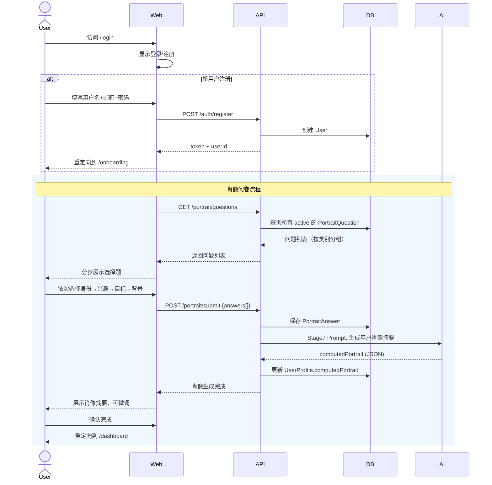
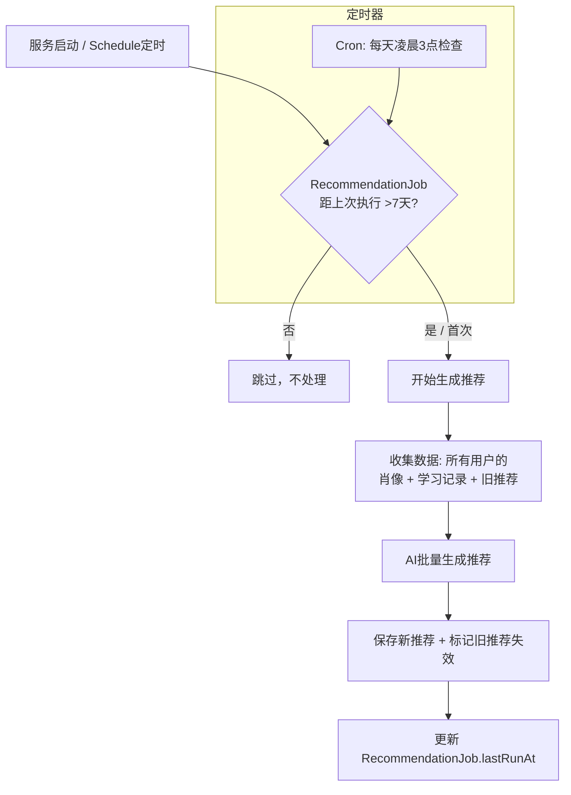
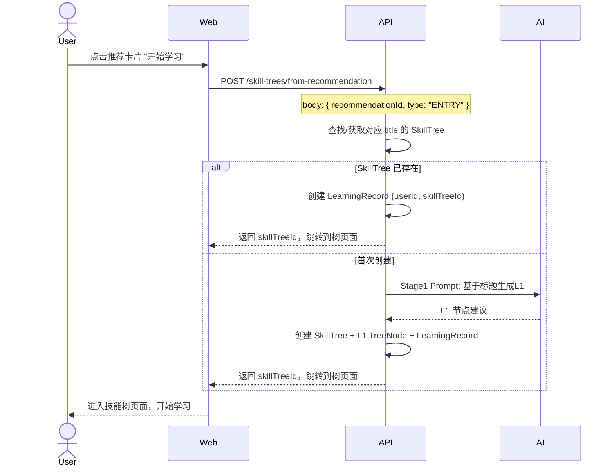
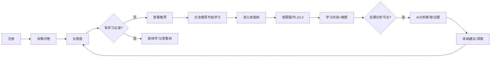
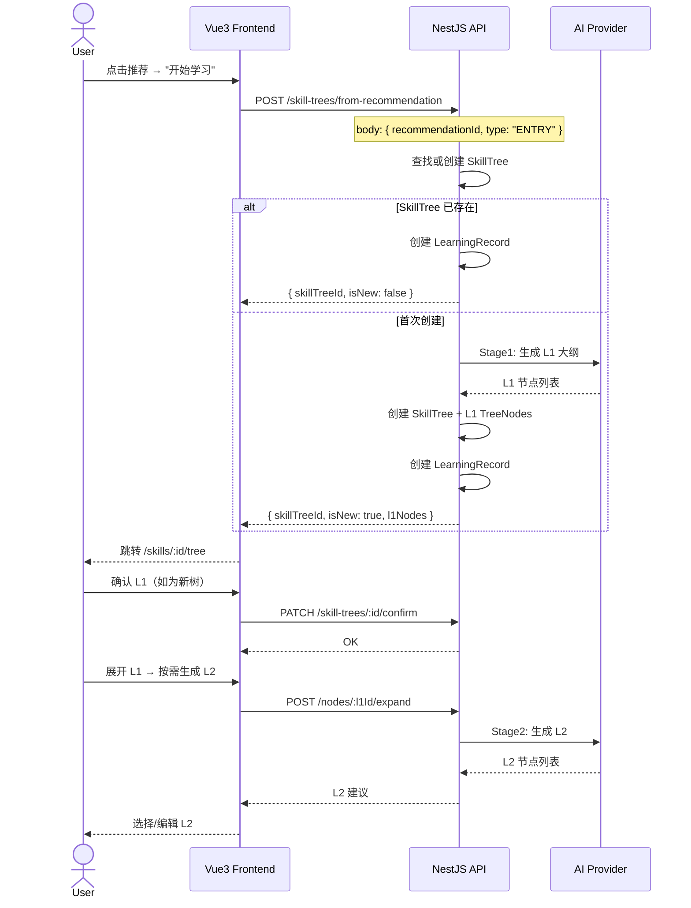

# 技能树学习系统 - 系统架构设计文档

## 一、设计概览

### 1.1 核心概念

| 概念 | 说明 |
|------|------|
| **技能方向 (SkillDirection)** | 一个完整的技能学习体系，如"前端工程化""Python 后端开发" |
| **技能树 (SkillTree)** | 每个技能方向下按模式拆分为独立的树：入门树、精进树、面试树 |
| **树节点 (TreeNode)** | 三层结构：L1(学什么) → L2(有什么内容) → L3(具体学什么) |
| **节点状态** | ACTIVE / OUTDATED_I(不太常用) / OUTDATED_II(建议不用) / OUTDATED_III(建议放弃) |
| **关键点 (KeyPoints)** | 节点的"内容快照"，供 AI 快速理解节点内涵，用于分析/更新场景 |
| **AI Provider** | AI 接入抽象层，默认读全局配置，后续可扩展为技能级覆盖 |
| **用户肖像 (UserPortrait)** | 通过身份/兴趣/目标等选择题构建的用户画像，用于个性化推荐 |
| **学习记录 (LearningRecord)** | 用户与技能方向的关联，表示"正在学/已学完/放弃" |

### 1.2 Monorepo 结构

```
skill-learning-monorepo/
├── apps/
│   ├── web/                          # Vue3 + Nuxt3 + Pinia + Tailwind
│   │   ├── pages/
│   │   │   ├── login.vue             # 登录页
│   │   │   ├── register.vue          # 注册页
│   │   │   ├── onboarding.vue        # 肖像问卷页（注册后引导）
│   │   │   ├── dashboard.vue         # 学习仪表盘（默认首页）
│   │   │   ├── skills/[id]/tree.vue  # 技能树页面
│   │   │   └── settings.vue          # 全局设置
│   │   ├── components/
│   │   │   ├── portrait/             # 肖像问卷组件
│   │   │   ├── dashboard/            # 仪表盘组件
│   │   │   ├── recommendation/       # 推荐组件
│   │   │   ├── tree/                 # 树组件系列
│   │   │   ├── content/              # 内容展示组件
│   │   │   ├── analysis/             # 分析面板组件
│   │   │   └── interview/            # 面试模式组件
│   │   ├── composables/
│   │   └── stores/
│   └── api/                          # NestJS
│       └── src/
│           ├── modules/
│           │   ├── auth/             # 认证模块（JWT）
│           │   ├── user/             # 用户模块
│           │   ├── portrait/         # 肖像问卷模块
│           │   ├── learning-record/  # 学习记录模块
│           │   ├── recommendation/   # 推荐模块（含定时任务）
│           │   ├── skill-tree/       # 技能树模块
│           │   ├── tree-node/        # 节点模块
│           │   ├── content/          # 内容模块
│           │   ├── exercise/         # 练习题模块
│           │   ├── analysis/         # AI 分析模块
│           │   ├── ai-integration/   # AI 接入层模块
│           │   └── config/           # 全局配置模块
│           └── common/
├── packages/
│   ├── @skill/shared/                # 共享类型、常量、枚举
│   ├── @skill/ai-provider/           # AI Provider 抽象层
│   └── @skill/prompt-manager/        # Prompt 模板管理
└── pnpm-workspace.yaml
```

---

## 二、数据模型设计

### 2.1 核心实体关系

```mermaid
erDiagram
    User ||--o| UserProfile : has
    User ||--o{ LearningRecord : has
    User ||--o{ Recommendation : receives
    UserProfile ||--o{ PortraitAnswer : contains
    PortraitQuestion ||--o{ PortraitAnswer : answered_by
    LearningRecord ||--o| SkillTree : tracks
    Recommendation ||--o| SkillTree : "nullable, may refer to"
    SkillTree ||--o{ TreeNode : contains
    TreeNode ||--o{ TreeNode : "parent-child"
    TreeNode ||--o| NodeContent : "L3 only"
    NodeContent ||--o{ Exercise : contains
    TreeNode ||--o{ AnalysisJob : "L1 or L2 target"
    AnalysisJob ||--o{ SuggestedChange : produces

    User {
        string id PK
        string username
        string email
        string passwordHash
        string avatar
        enum role "USER | ADMIN"
        datetime createdAt
        datetime updatedAt
    }

    UserProfile {
        string id PK
        string userId FK "unique"
        json computedPortrait "AI生成的肖像摘要，用于推荐"
        datetime portraitUpdatedAt
        datetime createdAt
        datetime updatedAt
    }

    PortraitQuestion {
        string id PK
        string category "IDENTITY | INTEREST | GOAL | BACKGROUND"
        string question
        json options "string[]"
        bool allowMultiple "true=多选 | false=单选"
        int sortOrder
        bool active
        datetime createdAt
    }

    PortraitAnswer {
        string id PK
        string profileId FK
        string questionId FK
        json selectedOptions "string[]"
        datetime createdAt
    }

    LearningRecord {
        string id PK
        string userId FK
        string skillTreeId FK
        enum status "IN_PROGRESS | COMPLETED | ABANDONED"
        datetime startedAt
        datetime completedAt
    }

    Recommendation {
        string id PK
        string userId FK
        string skillTreeId FK "nullable, 如果是已有技能方向则关联"
        string title
        text description
        text reason "AI生成的推荐理由（基于用户肖像的什么方面）"
        string source "AI_GENERATED | MANUAL"
        bool isActive "true=当前活跃推荐 | false=已被替换"
        int sortOrder
        datetime createdAt
        datetime expireAt "该推荐失效时间（下周更新时）"
    }

    RecommendationJob {
        string id PK "singleton record"
        datetime lastRunAt
        enum status "RUNNING | COMPLETED | FAILED"
        string error
        datetime createdAt
        datetime updatedAt
    }

    SkillTree {
        string id PK
        string name "技能方向名称"
        string description
        enum type "ENTRY | EXPERT | INTERVIEW"
        enum status "ACTIVE | ARCHIVED"
        datetime createdAt
        datetime updatedAt
    }

    TreeNode {
        string id PK
        string treeId FK
        string parentId FK "nullable for L1"
        int level "1 | 2 | 3"
        string title
        text description
        text keyPoints "关键点说明，供AI快速理解"
        enum status "ACTIVE | OUTDATED_I | OUTDATED_II | OUTDATED_III"
        int sortOrder
        datetime createdAt
        datetime updatedAt
    }

    NodeContent {
        string id PK
        string nodeId FK "unique, L3专属"
        text coreText "精简核心文本"
        int version
        datetime createdAt
        datetime updatedAt
    }

    Exercise {
        string id PK
        string nodeContentId FK
        string question
        json options "string[]"
        int correctIndex
        text explanation
        int sortOrder
    }

    AnalysisJob {
        string id PK
        string targetNodeId FK "L1或L2节点"
        enum analysisType "DISCOVER_NEW | CHECK_EXPIRE"
        text promptSnapshot "生成的prompt原文"
        json rawResponse "AI原始返回"
        enum status "PENDING | COMPLETED | FAILED"
        datetime createdAt
    }

    SuggestedChange {
        string id PK
        string analysisJobId FK
        enum action "ADD | EXPIRE"
        string title
        text description
        text keyPoints
        enum expireLevel "I | II | III" "action=EXPIRE时填写"
        bool applied "false"
        datetime createdAt
    }
```

### 2.2 关键字段详解

#### TreeNode.keyPoints

> 注：该字段为二期"新增/过期分析"的设计，当前代码中暂未包含（一期清理时移除，实现分析功能时再加回）。

节点的"内容指纹"，用于 AI 分析时快速理解节点含义，不必遍历子节点全部内容。

```
示例（L2 节点 "Docker 容器化"）：
keyPoints: "Dockerfile 编写|docker-compose 编排|镜像优化|容器网络|与 CI/CD 集成"
```

作用场景：
- L1 分析新增/过期 → 读取所有 L2 的 keyPoints 传给 AI，AI 基于此判断
- L2 分析新增/过期 → 读取所有 L3 的 keyPoints 传给 AI
- 不需要遍历完整内容树，效率高

#### TreeNode.status 与过期等级

| 状态 | 标识 | 含义 | 对用户的影响 |
|------|------|------|-------------|
| ACTIVE | - | 活跃内容 | 正常显示 |
| OUTDATED_I | ⚠️ I | 不太常用 | 显示灰色标记，内容仍可查看 |
| OUTDATED_II | ⚠️ II | 建议不用 | 默认折叠，用户展开后仍可查看 |
| OUTDATED_III | ❌ III | 建议放弃 | 仅在学习树骨架中可见，可被"清理"彻底移除 |

#### UserProfile.computedPortrait

用户完成问卷后，AI 基于其答案生成的肖像摘要，用于推荐系统。

```
示例：
{
  "summary": "3年前端开发经验，正在向全栈方向转型，
             对云原生和AI应用开发感兴趣，偏好实战型学习路径",
  "identityTags": ["前端工程师", "3-5年经验", "互联网行业"],
  "interestTags": ["云原生", "AI应用", "全栈"],
  "goalTags": ["职业转型", "技术广度提升"],
  "learningStyle": "hands-on"
}
```

---

## 三、用户肖像系统

### 3.1 注册与肖像设置流程



### 3.2 肖像问卷题目设计

题目分为 4 个类别，每类 3-5 题，优先支持**多选**以获取丰富信息，每题答案同时影响 `computedPortrait` 的生成。

| 类别 | 题目示例 | 选项示例 | 影响维度 |
|------|----------|----------|----------|
| **身份 IDENTITY** | 你当前的职业身份是什么？ | 学生/前端开发/后端开发/全栈/产品/设计师/其他 | identityTags |
| **身份 IDENTITY** | 你的工作年限？ | <1年/1-3年/3-5年/5-10年/10年+ | 经验层级 |
| **兴趣 INTEREST** | 你对哪些技术领域感兴趣？（多选） | 云原生/AI与机器学习/微服务/低代码/DevOps/安全 | interestTags |
| **兴趣 INTEREST** | 你偏好的学习方式？ | 视频教程/文档阅读/实战项目/交互式练习 | learningStyle |
| **目标 GOAL** | 你当前的主要学习目标？（多选） | 求职面试/技术转型/晋升加薪/兴趣拓展/解决当前工作问题 | goalTags |
| **目标 GOAL** | 你希望学习的深度？ | 够用就行/系统掌握/深入原理/成为专家 | depthPreference |
| **背景 BACKGROUND** | 你当前的编程基础？ | 零基础/有基础/熟练/精通 | skillLevel |
| **背景 BACKGROUND** | 你每天能投入的学习时间？ | <30分钟/30-60分钟/1-2小时/2小时+ | timeBudget |

设计原则：
- 题目本身由系统预置（可配置），不是 AI 生成
- 答案格式化后拼入 prompt，由 AI 生成肖像摘要
- 支持后续增删改题目（后端接口管理）

### 3.3 肖像摘要生成 Prompt（Stage 7）

```
角色: 你是一个用户画像分析师
任务: 基于用户的问卷调查答案，生成用户肖像摘要

输入:
- 身份信息: {{identityAnswers}}
- 兴趣偏好: {{interestAnswers}}
- 学习目标: {{goalAnswers}}
- 背景信息: {{backgroundAnswers}}

输出要求:
1. summary: 一段自然语言描述（50字以内），概括用户当前状态
2. identityTags: 3-5个身份标签
3. interestTags: 3-5个兴趣标签
4. goalTags: 2-4个目标标签
5. learningStyle: 学习偏好标签

输出格式 (JSON):
{
  "summary": "...",
  "identityTags": ["...", "..."],
  "interestTags": ["...", "..."],
  "goalTags": ["...", "..."],
  "learningStyle": "..."
}
```

---

## 四、仪表盘页面设计

### 4.1 页面布局

```mermaid
flowchart TD
    DASHBOARD[Dashboard Page /dashboard]
    DASHBOARD --> HEADER[顶部: 问候 + 肖像摘要]
    DASHBOARD --> SKILL_SECTION["我的学习 (列表/Grid切换)"]
    DASHBOARD --> RECOMMEND_SECTION["推荐学习方向"]

    SKILL_SECTION --> HAS_SKILL{有学习记录?}
    HAS_SKILL --> YES[渲染 SkillCard 列表/Grid]
    HAS_SKILL --> NO[空状态 + "探索推荐" CTA]

    RECOMMEND_SECTION --> CARD_LIST[RecommendationCard × 最多10个]
```

### 4.2 路由更新

```
/login                           → 登录页
/register                        → 注册页
/onboarding                      → 肖像问卷引导页（首次登录后）
/dashboard                       → 学习仪表盘（登录后默认首页）
/skills/create                   → 创建新技能（输入名称+选择模式）
/skills/:id/tree                 → 技能树主页
/skills/:id/interview            → 面试模式视图
/settings                        → 全局设置
```

### 4.3 仪表盘组件树

```
DashboardPage.vue
├── DashboardHeader.vue           # 用户欢迎语 + 肖像标签 + 设置入口
├── LearningSection.vue           # "我的学习" 区块
│   ├── SectionToolbar.vue        # 标题 + 视图切换 (List/Grid)
│   ├── LearningSkillGrid.vue     # Grid 布局
│   │   └── SkillCard.vue         # 技能卡
│   │       ├── SkillName.vue     # 技能名称 + 模式标记 (入门/精进/面试)
│   │       ├── SkillProgress.vue # 学习进度指示
│   │       └── ActionButtons.vue # 继续学习 / 删除
│   ├── LearningSkillList.vue     # List 布局
│   │   └── SkillListItem.vue     # 列表项 (同上信息，横向布局)
│   └── EmptyState.vue            # 空状态: "还没有开始学习，去看看推荐吧"
└── RecommendationSection.vue     # "为你推荐" 区块
    ├── SectionHeader.vue         # 标题 + "每周更新" 标记
    └── RecommendationCard.vue    # 推荐卡片 × N
        ├── TitleAndTags.vue      # 方向名称 + 匹配标签
        ├── Description.vue       # 一句话描述
        ├── MatchReason.vue       # "为什么推荐：基于你的{xxx}..."
        └── ActionButton.vue      # "开始学习" → 创建技能树 + 进入
```

### 4.4 SkillCard 与 RecommendationCard 视觉示意

```
┌─────────────────────────┐        ┌─────────────────────────┐
│  前端工程化              │        │  AI应用开发              │
│  🏷️ 入门 · 精进 · 面试  │        │  🏷️ 推荐理由: 你正在向   │
│  ████████░░ 68%         │        │     全栈转型...         │
│  [继续学习]              │        │  🔗 匹配: 兴趣 + 目标   │
└─────────────────────────┘        │  [开始学习]              │
    SkillCard (我的学习)            └─────────────────────────┘
                                         RecommendationCard
```

---

## 五、推荐系统

### 5.1 定时任务逻辑



### 5.2 推荐生成 Prompt（Stage 8）

```
角色: 你是一个个性化学习路径规划师
任务: 基于用户的肖像和当前学习情况，推荐最适合的 10 个学习方向

输入:
- 用户肖像:
  {{portraitSummary}}
  身份标签: {{identityTags}}
  兴趣标签: {{interestTags}}
  目标标签: {{goalTags}}
  学习风格: {{learningStyle}}

- 正在学习的技能:
{{#each learningSkills}}
  - {{title}} ({{type}}) - {{description}}
{{/each}}

- 上周推荐（待筛选替换）:
{{#each oldRecommendations}}
  - {{title}} - {{reason}}
{{/each}}

要求:
1. 输出恰好 10 个推荐方向
2. 综合考量用户肖像、已有学习技能、旧推荐
3. 排除用户已经在学的方向
4. 从旧推荐中保留仍适合的，补充新的
5. 每个推荐需附具体理由（结合用户肖像的哪个维度）
6. 方向要有层次: 基础与进阶搭配

输出格式 (JSON):
{
  "recommendations": [
    {
      "title": "..."               // 学习方向名称，如"云原生架构"
      "description": "..."         // 一句话描述
      "reason": "..."              // 推荐理由，如"你对云原生感兴趣且有后端基础"
      "matchTags": ["兴趣", "目标"] // 匹配维度标签，前端展示用
      "suggestedMode": "ENTRY"     // 建议从哪个模式开始
    }
  ]
}
```

### 5.3 推荐替换逻辑

```typescript
// api/src/modules/recommendation/recommendation.service.ts

async generateRecommendationsForAllUsers() {
  // 1. 检查是否需要运行
  const job = await this.recommendationJobRepo.findOne();
  if (job && dayjs().diff(job.lastRunAt, 'day') < 7) return;

  // 2. 标记运行中
  await this.recommendationJobRepo.upsert({ status: 'RUNNING' });

  // 3. 逐个用户处理（可并行）
  const users = await this.userRepo.find();
  await Promise.all(users.map(user => this.generateForUser(user.id)));

  // 4. 更新任务记录
  await this.recommendationJobRepo.upsert({
    lastRunAt: new Date(),
    status: 'COMPLETED',
  });
}

async generateForUser(userId: string) {
  // 收集数据
  const portrait = await this.portraitService.getComputed(userId);
  const learningSkills = await this.learningRecordRepo.findActive(userId);
  const oldRecs = await this.recommendationRepo.findActive(userId);

  // 调用 AI
  const result = await this.aiService.chat(RECOMMEND_PROMPT, {
    portrait,
    learningSkills,
    oldRecommendations: oldRecs,
  });

  // 标记旧推荐失效
  await this.recommendationRepo.deactivateAll(userId);

  // 保存新推荐
  const recs = result.recommendations.map((r, i) => ({
    userId,
    title: r.title,
    description: r.description,
    reason: r.reason,
    source: 'AI_GENERATED',
    isActive: true,
    sortOrder: i,
    createdAt: new Date(),
  }));
  await this.recommendationRepo.save(recs);
}
```

### 5.4 从推荐创建学习方向



---

## 六、核心业务流程

### 6.1 完整用户旅程



### 6.2 创建技能方向（接推荐）



---

## 七、前端路由与组件设计

### 7.1 完整路由表

```
/login                           → 登录页
/register                        → 注册页
/onboarding                      → 肖像问卷引导（首次登录）
/dashboard                       → 学习仪表盘（默认首页）
/skills/create                   → 手动创建技能方向
/skills/:id/tree                 → 技能树主页
/skills/:id/interview            → 面试模式视图
/settings                        → 全局设置
/settings/portrait               → 重新编辑肖像问卷
```

### 7.2 完整组件树

```
// 认证相关
LoginPage.vue
RegisterPage.vue

// 肖像问卷
OnboardingPage.vue
├── PortraitProgressBar.vue       # 分步进度条（4步: 身份→兴趣→目标→背景）
├── PortraitQuestionStep.vue      # 单步问题卡片
│   ├── QuestionTitle.vue          # 问题标题
│   ├── MultiChoiceGroup.vue       # 多选项组（复选框/按钮组）
│   └── SingleChoiceGroup.vue      # 单选项组（单选按钮）
└── PortraitSummary.vue           # 确认页（展示AI生成的肖像摘要）
    ├── PortraitTags.vue           # 标签云展示
    └── EditButton.vue             # "不太对，重新生成"

// 仪表盘
DashboardPage.vue
├── DashboardHeader.vue            # 用户欢迎语 + 肖像标签条 + 设置入口
├── LearningSection.vue            # "我的学习" 区块
│   ├── SectionToolbar.vue         # 标题 + 视图切换按钮组 (ListIcon/GridIcon)
│   ├── LearningSkillGrid.vue      # Grid 布局（2列/3列响应式）
│   │   └── SkillCard.vue
│   │       ├── SkillCardFront.vue # 正面: 名称+模式+进度条
│   │       └── SkillCardActions.vue # 操作: 继续学习/放弃
│   ├── LearningSkillList.vue      # List 布局
│   │   └── SkillListItem.vue
│   └── EmptyState.vue             # 空状态插画 + "去看看推荐"
└── RecommendationSection.vue      # "为你推荐"
    ├── SectionHeader.vue          # 标题 + "每周更新" 小标记 + 上次更新时间
    └── RecommendationCard.vue × N
        ├── MatchTags.vue          # 匹配标签（兴趣/目标/身份）
        ├── RecommendationReason.vue # 个性化理由
        └── StartLearningButton.vue # "开始学习"

// 技能树（当前实现：Vue Flow 画布 + 左侧目录 + 右侧抽屉）
pages/skills/[id]/tree.vue        # fullscreen 布局，组合以下三部分
├── TreeDirectoryPanel.vue        # 左侧目录：L1→L2 列表、点击定位/折叠、状态圆点
│   └── TreeLearningStatusDot.vue # 学习状态圆点（学习中/已完成/跳过）
├── TreeVueFlowGraph.vue          # @vue-flow/core 画布：平移/缩放、连线、fitView
│   └── TreeFlowNode.vue          # 自定义节点：标题/描述、时效徽标、学习状态、L1 展开按钮
└── TreeL2ContentPanel.vue        # 右侧抽屉（选中 L2 时打开）
    ├── 学习状态切换按钮组         # 未开始/学习中/已完成/跳过
    ├── TreeL3Content.vue         # L3 内容：Markdown 渲染、代码高亮/复制
    │   └── TreeExerciseCard.vue  # 练习题卡片（选项选择/判分/解析）
    └── 骨架屏 / 错误重试          # L3 内容按需生成（POST /nodes/:id/content）

状态与布局：
├── composables/useSkillTreePage.ts # 页面状态：选中/折叠、内容加载、学习状态更新
├── composables/useTreeLayout.ts    # 树数据 → Vue Flow nodes/edges（根→L1→L2 横向布局）
└── utils/learning-status.ts        # 学习状态元信息（label/徽标/圆点类名）

// 注：分析面板（新增/过期建议）为二期设计，当前未实现

InterviewView.vue
├── InterviewQuestionCard.vue
└── DifficultyFilter.vue

SettingsPage.vue                  # 当前仅展示登录用户名 + "清除本地缓存"（AI 配置已移至 .env）
```

---

## 八、API 端点设计

### 8.1 认证

| 方法 | 路径 | 说明 |
|------|------|------|
| POST | /api/auth/register | 注册 |
| POST | /api/auth/login | 登录（返回 JWT） |

### 8.2 用户肖像

| 方法 | 路径 | 说明 |
|------|------|------|
| GET | /api/portrait/questions | 获取所有活跃的肖像问卷题目（按类别分组） |
| POST | /api/portrait/submit | 提交问卷答案 + AI生成肖像摘要（原始答案落库 PortraitAnswer） |
| PUT | /api/portrait/questions | 【管理端】增删改问卷题目 |

### 8.3 仪表盘

| 方法 | 路径 | 说明 |
|------|------|------|
| GET | /api/dashboard | 获取仪表盘数据（学习记录 + 推荐列表） |

### 8.4 推荐

| 方法 | 路径 | 说明 |
|------|------|------|
| GET | /api/recommendations | 获取当前活跃推荐列表 |
| POST | /api/recommendations/refresh | 手动触发推荐刷新 |
| GET | /api/recommendations/job-status | 获取定时任务状态 |

### 8.5 学习记录

| 方法 | 路径 | 说明 |
|------|------|------|
| GET | /api/learning-records | 获取用户的所有学习记录 |
| POST | /api/learning-records | 创建学习记录（关联技能树） |
| PATCH | /api/learning-records/:id | 更新学习状态 |
| DELETE | /api/learning-records/:id | 删除学习记录（放弃学习） |

### 8.6 从推荐创建技能方向

| 方法 | 路径 | 说明 |
|------|------|------|
| POST | /api/skill-trees/from-recommendation | 从推荐创建技能树（含系统自动生成L1） |

### 8.7 技能树（已有）

| 方法 | 路径 | 说明 |
|------|------|------|
| POST | /api/skill-trees | 手动创建技能方向 |
| GET | /api/skill-trees | 技能方向列表 |
| GET | /api/skill-trees/:id | 技能树详情 |
| PATCH | /api/skill-trees/:id | 更新技能树 |
| DELETE | /api/skill-trees/:id | 删除技能树 |

### 8.8 节点操作（已有）

| 方法 | 路径 | 说明 |
|------|------|------|
| GET | /api/nodes/:id/children | 获取子节点 |
| POST | /api/nodes/:id/expand | 按需展开（AI生成下一级） |
| GET | /api/nodes/:id | 节点详情 |
| PATCH | /api/nodes/:id | 编辑节点 |
| PATCH | /api/nodes/batch-confirm | 批量确认节点 |
| DELETE | /api/nodes/:id | 删除节点 |

### 8.9 内容与练习（已有）

| 方法 | 路径 | 说明 |
|------|------|------|
| POST | /api/nodes/:id/content | 生成/获取L3内容 |
| GET | /api/nodes/:id/content | 获取L3内容 |
| PATCH | /api/nodes/:id/content | 编辑内容 |

### 8.10 分析（已有）

| 方法 | 路径 | 说明 |
|------|------|------|
| POST | /api/nodes/:id/analyze | 触发AI分析 |
| GET | /api/analysis/:jobId/results | 获取分析结果 |
| POST | /api/analysis/:jobId/apply | 采纳建议 |
| DELETE | /api/nodes/:id/cleanup | 清理节点 |

### 8.11 面试模式（已有）

| 方法 | 路径 | 说明 |
|------|------|------|
| GET | /api/skill-trees/:id/interview | 获取面试模式视图 |

### 8.12 配置（已有）

| 方法 | 路径 | 说明 |
|------|------|------|
| GET | /api/config/ai | 获取AI全局配置 |
| PUT | /api/config/ai | 更新AI全局配置 |

---

## 九、Prompt 阶段汇总

| Stage | 名称 | 触发时机 | 输出 |
|-------|------|----------|------|
| 1 | 生成 L1 大纲 | 创建技能方向 | L1 节点列表 |
| 2 | 展开 L2 | 展开 L1 | L2 节点列表 |
| 3 | 生成 L3 内容 | 展开 L2 | 核心文本 + 练习题 |
| 4 | 分析新增节点 | L1/L2 分析 | 建议新增的节点 |
| 5 | 分析过期节点 | L1/L2 分析 | 建议标记过期的节点 |
| 6 | 面试视图 | 查看面试模式 | 面试 Q&A 列表 |
| **7** | **生成肖像摘要** | **用户提交问卷** | **用户肖像 JSON** |
| **8** | **生成推荐** | **每周定时任务** | **推荐列表 × 10** |

---

## 十、NestJS 模块新增

### 10.1 api/src/modules/ 新增模块

```
modules/
├── auth/                          # 认证
│   ├── auth.module.ts
│   ├── auth.controller.ts
│   ├── auth.service.ts
│   └── strategies/
│       └── jwt.strategy.ts
├── user/                          # 用户
│   ├── user.module.ts
│   ├── user.controller.ts
│   └── user.service.ts
├── portrait/                      # 肖像问卷
│   ├── portrait.module.ts
│   ├── portrait.controller.ts
│   ├── portrait.service.ts
│   └── portrait-ai.service.ts     # 调用AI生成肖像摘要
├── learning-record/               # 学习记录
│   ├── learning-record.module.ts
│   ├── learning-record.controller.ts
│   └── learning-record.service.ts
└── recommendation/                # 推荐
    ├── recommendation.module.ts
    ├── recommendation.controller.ts
    ├── recommendation.service.ts
    ├── recommendation-ai.service.ts # 调用AI生成推荐
    └── recommendation-scheduler.ts  # 定时任务（@Cron）
```

### 10.2 定时任务配置

```typescript
// recommendation-scheduler.ts
@Injectable()
export class RecommendationScheduler {
  constructor(private readonly recService: RecommendationService) {}

  // 每天凌晨 3 点检查是否需要刷新
  @Cron('0 3 * * *')
  async handleCron() {
    await this.recService.checkAndGenerate();
  }

  // 服务启动时立即检查
  @OnApplicationBootstrap()
  async handleBootstrap() {
    await this.recService.checkAndGenerate();
  }
}
```

```typescript
// recommendation.service.ts
async checkAndGenerate(): Promise<void> {
  const job = await this.jobRepo.findOne({ where: { id: 'singleton' } });
  const lastRun = job?.lastRunAt ?? new Date(0);
  const daysSince = dayjs().diff(lastRun, 'day');

  if (daysSince >= 7) {
    await this.generateForAllUsers();
  }
}
```

---

## 十一、关键设计决策总表

| 决策 | 结论 |
|------|------|
| 入门 vs 精进关系 | 独立两棵树，各自生成和管理 |
| 面试模式 | 同一棵树的独立视图（基于已有L3重组织） |
| 树生成策略 | 按需展开（L1创建时生成骨架，展开时渐进生成） |
| 时效粒度 | L2/L3独立，通过 keyPoints 快速判断 |
| 过期影响 | 仅标记不影响内容查看，OUTDATED_III可被清理 |
| AI Provider | 全局配置 → 抽象层（Provider模式）→ 后续可扩展到技能级 |
| 版本管理 | 暂不需要 |
| Prompt策略 | **8个阶段**，每个阶段独立模板，JSON Schema约束 |
| 肖像问卷 | 系统预置4类题目（身份/兴趣/目标/背景），AI生成摘要 |
| 推荐时机 | 服务启动 + 每天Cron检查，>7天则刷新 |
| 推荐数量 | 固定10个，保留旧推荐中仍适合的 |
| 推荐来源 | 用户肖像 + 已有学习 + 旧推荐，传AI综合分析 |
| 仪表盘 | 默认登录页，支持 List/Grid 切换 |
| 布局 | 支持 List 和 Grid 两种视图模式 |
